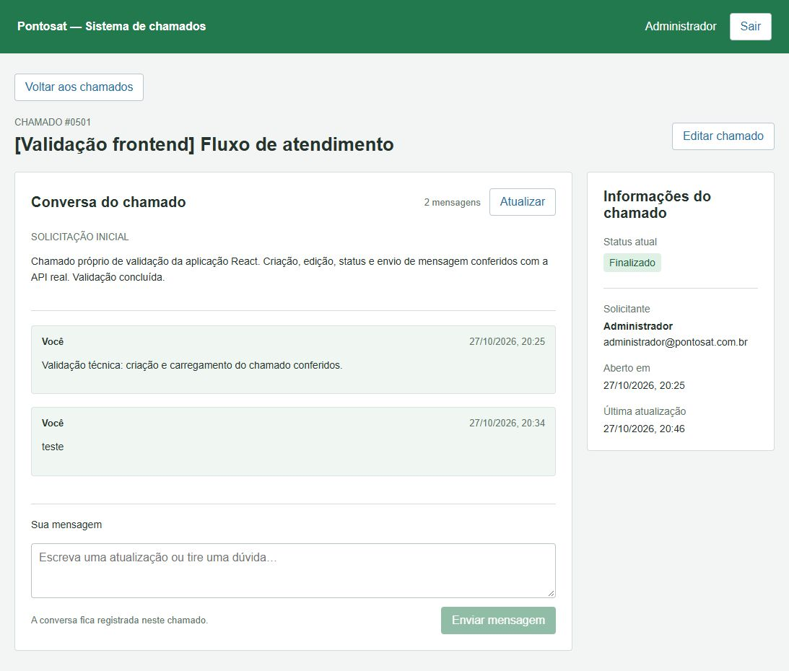

# Pontosat — Sistema de chamados

Frontend do desafio Pontosat, feito com React, JavaScript e CSS. Usa verde, laranja e azul para diferenciar os status.



## Como executar

É necessário ter Node.js 22.12 ou mais recente e npm.

No PowerShell, dentro da pasta do projeto:

```powershell
npm.cmd ci
Copy-Item .env.example .env
npm.cmd run dev
```

Abra o endereço exibido no terminal, normalmente http://127.0.0.1:5173. Use a conta disponibilizada pela empresa. A senha não está salva no projeto.

Para conferir o build e os testes:

```powershell
npm.cmd run build
npm.cmd test
```

## O que a aplicação faz

- Login e saída da conta.
- Consulta dos chamados com busca, filtro de status e paginação.
- Criação e edição de título, descrição e status.
- Visualização da descrição, solicitante e datas.
- Leitura do histórico e envio de mensagens no chamado.
- Avisos de carregamento, erro e lista vazia.

## Organização do código

- `src/App.jsx`: login, listagem e navegação entre as telas.
- `src/components/TicketForm.jsx`: formulário de criação e edição.
- `src/components/TicketDetail.jsx`: informações do chamado e conversa.
- `src/components/ui.jsx`: rótulo de status e aviso de erro.
- `src/api.js`: chamadas HTTP, token e filtros da API.
- `src/presentation.js`: nomes dos status e formatação de datas.
- `src/styles.css`: aparência e adaptação para telas menores.

Os componentes usam `useState` para guardar os dados da tela e `useEffect` para buscar dados na API. As requisições são feitas com `fetch`. O token fica em `sessionStorage`, sem guardar a senha.

React e React DOM montam a interface. Vite executa e gera o build. React Markdown exibe a formatação das descrições e mensagens recebidas da API, sem habilitar HTML arbitrário. Vitest verifica a montagem dos filtros; Prettier formata o código. O enunciado permite escolher bibliotecas.

## API e material utilizado

A aplicação usa o enunciado e a [documentação disponibilizada pela empresa](http://api-segunda-fase.pontosat.net.br:29461/docs). Uma cópia do contrato consultado está em `docs/openapi.json`.

Os dados de usuários, chamados e mensagens vêm exclusivamente dessa API. Não há dados fictícios locais, imagens de bancos externos, fontes externas ou serviços adicionais. O texto “Pontosat” no cabeçalho identifica a empresa; não é um arquivo de logotipo oficial fornecido por ela. As três cores foram solicitadas para esta implementação; não foram disponibilizados códigos oficiais de cor.

Endpoints usados: `/login`, `/me`, `/users`, `/tickets`, `/tickets/{id}` e `/ticket-interaction`, todos sob `/api/v2`. A API não possui consulta individual de chamado: os detalhes são obtidos da listagem. Também não há campos de prioridade ou responsável pelo atendimento no contrato.

## Observação sobre hospedagem

A API fornecida usa HTTP. No desenvolvimento, o proxy do Vite encaminha `/api` para ela. Uma hospedagem HTTPS precisa de um proxy HTTPS ou de uma versão HTTPS da API, para evitar bloqueio de conteúdo misto. `npm.cmd run preview` serve o build, mas não inclui o proxy de desenvolvimento.

A variável `VITE_API_BASE_URL` permite configurar outra origem para a mesma API. `API_PROXY_TARGET` configura o destino do proxy local. Veja `.env.example`.

## Verificação

O fluxo completo foi testado na API usando o chamado próprio #501: criar, enviar mensagem, editar descrição e alterar de aberto para em atendimento e finalizado. Os testes automatizados verificam a composição dos filtros. Eles não substituem a conferência manual de toda a aplicação.

A revisão de escopo está em `docs/revisao-escopo.md`.

Entrega solicitada: repositório público no GitHub até **03/11/2026 às 12h, horário de Brasília**.
